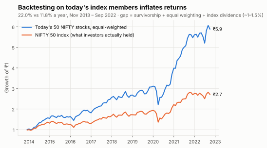
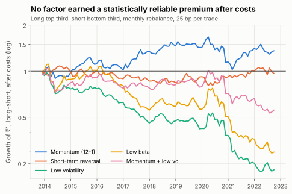
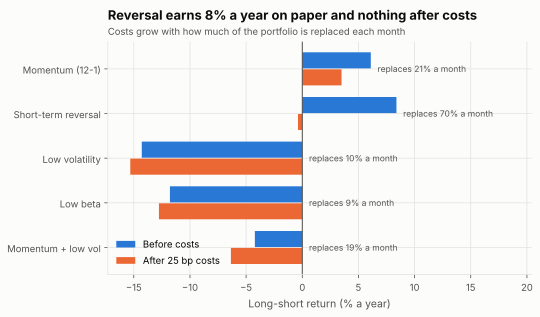
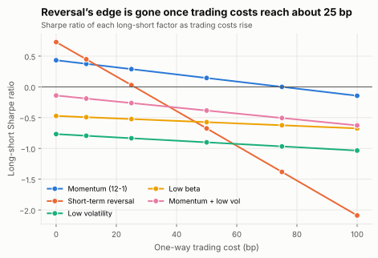
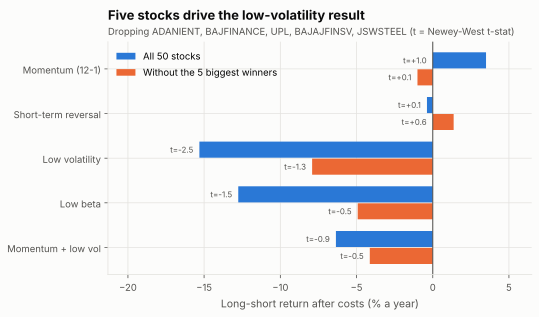
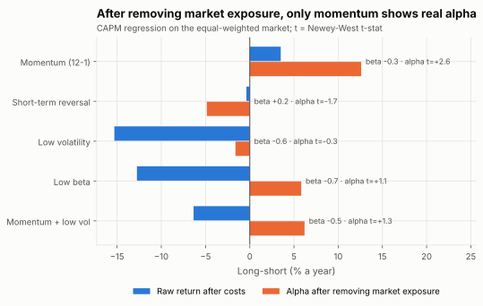

# Alpha Autopsy
### Five classic equity factors, ten years of NIFTY-50 data, and the bias that fakes most of the alpha

*Alpha Autopsy* backtests five well-known stock-selection signals on India's
largest companies. The point is not to find a strategy that "works". It is to
show, step by step, why most backtests that appear to work are wrong, and what
is left once the usual mistakes are removed.

**Universe:** the 50 NIFTY-50 constituents as of 2022 · **Period:** Nov 2013 – Sep 2022 (107 months) ·
**Rebalance:** monthly · **Costs:** 25 bp per unit traded

---

## Key findings

| # | Finding | Evidence |
|---|---------|----------|
| 1 | **Survivorship bias is large.** Equal-weighting the stocks that are in the NIFTY 50 *today* earned **22.0% a year**, against **11.8%** for the index investors actually held. Part of the 10-point gap is equal weighting and the index's missing dividends (about 1–1.5% a year), but most of it comes from picking the winners after the fact. | Fig. 1 |
| 2 | **No factor earned a reliable raw premium after costs.** The best, momentum, made 3.5% a year (t = 1.0). | Fig. 2 |
| 3 | **Trading costs destroy high-turnover signals.** Short-term reversal earns 8.4% a year before costs and −0.4% after, because it replaces about 70% of its holdings every month. | Figs. 3, 4 |
| 4 | **The low-volatility "anomaly" runs backwards here (−15% a year, t = −2.5), but that is not alpha.** The long-short portfolio has a market beta of −0.61, so it is effectively short a market that rose 22% a year. Once that exposure is removed, its alpha is −1.6% (t = −0.3). | Fig. 6 |
| 5 | **Five stocks drive the low-vol result.** Adani Enterprises, Bajaj Finance, UPL, Bajaj Finserv and JSW Steel were volatile *and* became huge winners, which is exactly how they ended up in the 2022 index. Without them, the low-vol loss halves and is no longer significant (t = −1.3). | Fig. 5 |
| 6 | **Momentum is the one survivor, with caveats.** Its market-adjusted alpha is **12.6% a year (t = 2.6)**. It is similar in both halves of the sample (12.7% and 10.3%), still 9.3% (t = 2.1) without the five biggest winners, and just passes a Holm correction for testing five factors (p = 0.048). It is measured in a survivorship-biased universe, so treat it as a lead to test on clean data, not a strategy. | Figs. 5, 6 |

### Results table (long top third, short bottom third, after 25 bp costs)

| Factor | Before costs | After costs | t-stat | Market beta | Alpha | Alpha t | Share replaced / month | Holm p (alpha) |
|---|---|---|---|---|---|---|---|---|
| Momentum (12-1) | 6.1% | 3.5% | 1.0 | −0.35 | **12.6%** | **2.6** | 21% | **0.048** |
| Short-term reversal | 8.4% | −0.4% | 0.1 | +0.24 | −4.9% | −1.7 | 70% | 0.39 |
| Low volatility | −14.3% | −15.3% | −2.5 | −0.61 | −1.6% | −0.3 | 10% | 0.72 |
| Low beta | −11.8% | −12.8% | −1.5 | −0.79 | 5.8% | 1.1 | 9% | 0.56 |
| Momentum + low vol | −4.2% | −6.4% | −0.9 | −0.51 | 6.2% | 1.3 | 19% | 0.55 |

Returns are compound annual rates. Alpha is the annualised arithmetic intercept
of a regression on the equal-weighted market. All t-statistics use Newey-West
standard errors. Full output, including half-sample and long-only results, is in
[`results/summary.json`](results/summary.json).

---

## Figures

<p align="center"></p>

| | |
|---|---|
|  |  |
|  |  |

<p align="center"></p>

---

## The five signals

Each signal is computed at month-end *t* using data up to *t* only, and is used to
hold stocks from *t* to *t+1*.

| Signal | Definition | Idea |
|---|---|---|
| Momentum (12-1) | Return over months *t−11* to *t−1* | Recent winners keep winning (Jegadeesh & Titman, 1993) |
| Short-term reversal | Minus last month's return | Last month's losers bounce back |
| Low volatility | Minus the past year's daily volatility | Calm stocks earn more per unit of risk (Ang et al., 2006) |
| Low beta | Minus the past year's beta to the market | "Betting against beta" (Frazzini & Pedersen, 2014) |
| Momentum + low vol | Average of the two z-scored signals | A simple multi-factor blend |

## What makes this backtest trustworthy

- **No look-ahead.** A unit test corrupts every data point after month *t* and
  checks that the signals dated *t* do not change.
- **Data cleaning is documented and minimal.** Three problems in the source data
  were fixed, each with its reason in `src/factorlab/data.py`:
  - Adani Enterprises' 2015 demerger day, when the price fell 39% because shareholders received shares in other companies.
  - Two years of frozen HDFC prices.
  - A break in Tata Steel's adjusted price series in 2022.
- **Realistic costs.** Turnover is measured from drifted weights and charged on
  both legs of every long-short portfolio.
- **Honest statistics.** The tests use Newey-West t-statistics, which account for
  autocorrelation in monthly returns. A Holm correction accounts for testing five
  signals at once, and the sample is split in half to check stability.
- **Findings are explained, not just reported.** The surprising low-vol result is
  traced to market exposure and to five specific stocks.

## Limitations

- **The universe is the 2022 index, looked at backwards.** This is the biggest
  problem with the data and the main lesson of the project. A clean test needs
  point-in-time index membership, including stocks that dropped out.
- **Ten years and 50 stocks is a small sample.** Thirds hold only about 16 stocks
  each, so single names matter a lot (finding 5).
- **Price-only signals.** Value, quality and size need accounting data, which is
  not in this dataset.
- **The market benchmark is biased too.** Alphas are estimated against an
  equal-weighted market built from the same stocks. Because that market return is
  inflated, the alpha of negative-beta strategies is inflated as well. This
  applies to momentum's alpha (beta −0.35).
- **Shorting Indian stocks overnight needs borrowed stock, and lending is thin.** In practice the long-short
  results are a measure of the signal, not a tradable fund. The long-only
  comparisons against the equal-weighted market are in `results/summary.json`.

## Project structure

```
src/factorlab/
  data.py        load prices, apply the three documented fixes
  signals.py     monthly returns and the five signals (strict timing)
  backtest.py    monthly rebalancing, turnover and costs, long-short portfolios
  stats.py       Newey-West t-stats, CAPM alpha, Holm correction, drawdowns
  plotting.py    chart style
scripts/download_data.py   fetches the raw data (public mirrors of Yahoo Finance data)
experiments/run_all.py     reproduces every number and figure
tests/                     11 unit tests (look-ahead, costs, statistics, data fixes)
docs/INTERVIEW_GUIDE.md    plain-English walkthrough and likely interview questions
```

## How to run

```bash
pip install -r requirements.txt
python scripts/download_data.py     # about 11 MB into data/raw/
python -m pytest -q                 # 11 tests
python experiments/run_all.py       # figures + results/summary.json (~20 s)
```

## References

- Jegadeesh & Titman (1993). *Returns to Buying Winners and Selling Losers.* Journal of Finance.
- Ang, Hodrick, Xing & Zhang (2006). *The Cross-Section of Volatility and Expected Returns.* Journal of Finance.
- Frazzini & Pedersen (2014). *Betting Against Beta.* Journal of Financial Economics.
- Newey & West (1987). *A Simple, Positive Semi-Definite, Heteroskedasticity and Autocorrelation Consistent Covariance Matrix.* Econometrica.
- Harvey, Liu & Zhu (2016). *… and the Cross-Section of Expected Returns.* Review of Financial Studies.

---

Built with AI assistance (Claude). Code licensed under MIT. The price data
belongs to its original providers and is not redistributed here.
